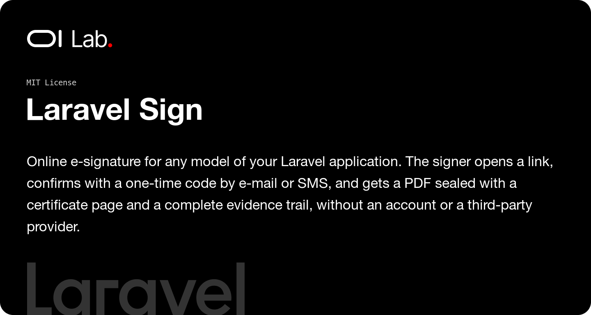

# Oi Laravel Sign

[](https://packagist.org/packages/oi-lab/oi-laravel-sign)
[](https://packagist.org/packages/oi-lab/oi-laravel-sign)
[](https://github.com/oi-lab/oi-laravel-sign/actions)
[](LICENSE)

Online e-signature for any model of a Laravel application — a quote, a contract, a purchase order. The
signer opens a link without an account, reads the document, declares their identity, consents, and
confirms with a one-time code sent by e-mail or SMS. The package then appends a "Signature certificate"
page to the PDF, seals it with the server's certificate, and keeps a timestamped evidence trail. No
third-party provider is involved: it is a simple electronic signature in the sense of eIDAS and article
1367 of the French Civil Code, enough to accept a quote.

## Features

- **Any model**: implement the `Signable` contract and use the `HasSignatureRequests` trait.
- **Public signing screens**: mobile-first Blade screens in the issuer's colors, in English and French.
- **One-time code** by e-mail or SMS: 6 digits, valid 10 minutes, 5 attempts, then a temporary lock.
- **Integrity**: the PDF is copied and fingerprinted (SHA-256) when the request is sent; a changed
  document version or an altered copy can no longer be signed.
- **Sealed PDF**: the original pages, a certificate page (declared identity, UTC date, verification
  method, fingerprints, transaction ID, evidence trail) and a PAdES-Basic seal that PDF readers check.
- **Evidence trail**: an append-only log of every step with IP, user agent and channel, exportable as JSON.
- **Retention**: files are written once and a signed request cannot be deleted for good before the end of
  its retention period (10 years by default).
- **Multi-tenant**: an optional `owner` morph ties each request to its organization.
- **Extensible**: drivers for the signature, the PDF sealer and the code channels; events for every outcome.

## How It Works

```
RequestSignature ──► document.pdf + attachments copied, SHA-256 stored, link mailed
       │
Signer opens /sign/{token} ──► viewed ──► identity + consent ──► code sent
       │
Code verified ──► fingerprint and version checked ──► certificate page + seal ──► signed.pdf
```

A request is `pending`, then `viewed`, until it is `signed`, `declined` by the signer, `cancelled` by the
issuer or `expired` (past its date, document modified, or model no longer signable).

## Requirements

- PHP 8.2+ with the OpenSSL extension
- Laravel 11, 12, or 13
- spatie/laravel-data ^4.23
- setasign/fpdi and tecnickcom/tcpdf (installed with the package)

## Installation

```bash
composer require oi-lab/oi-laravel-sign
```

### Publish & Migrate

```bash
php artisan vendor:publish --tag=oi-laravel-sign-config
php artisan migrate
```

Publish the screens, the certificate page and the translations to customize them:

```bash
php artisan vendor:publish --tag=oi-laravel-sign-stubs
```

### Seal certificate

The default `pades` sealer needs a certificate. For development, create a self-signed one:

```bash
php artisan sign:make-certificate
```

and copy the two printed lines into `.env`. In production, use a seal certificate issued by a trusted
authority (PEM + key, or a `.p12` bundle with `OI_SIGN_CERTIFICATE_PASSWORD`).

## Configuration

```php
// config/oi-laravel-sign.php
return [
    'route' => [
        'enabled' => env('OI_SIGN_ROUTES', true),   // public screens under /sign/{token}
        'prefix' => 'sign',
        'middleware' => ['web', 'throttle:oi-sign'],
        'rate_limit' => env('OI_SIGN_RATE_LIMIT', 30), // requests per minute and IP
    ],
    'disk' => env('OI_SIGN_DISK', env('FILESYSTEM_DISK', 'local')),
    'retention_years' => 10,
    'expires_in_days' => env('OI_SIGN_EXPIRES_IN_DAYS', 30),
    'consent_text' => 'Bon pour accord',
    'otp' => [
        'channel' => env('OI_SIGN_OTP_CHANNEL', 'mail'), // mail | sms
        'length' => 6, 'ttl_minutes' => 10, 'max_attempts' => 5, 'lockout_minutes' => 15,
        'sms' => ['via' => env('OI_SIGN_SMS_CHANNEL', 'vonage')],
    ],
    'sealer' => [
        'driver' => env('OI_SIGN_SEALER', 'pades'),  // pades | none | a PdfSealer class
        'certificate' => env('OI_SIGN_CERTIFICATE_PATH'),
        'private_key' => env('OI_SIGN_PRIVATE_KEY_PATH'),
    ],
    'expiration' => ['enabled' => true],             // schedules sign:expire hourly
];
```

## Usage

### Make a model signable

```php
use OiLab\OiLaravelSign\Concerns\HasSignatureRequests;
use OiLab\OiLaravelSign\Contracts\Signable;
use OiLab\OiLaravelSign\Data\BrandingData;
use OiLab\OiLaravelSign\Data\SignableAttachmentData;

class Quote extends Model implements Signable
{
    use HasSignatureRequests;

    public function signableTitle(): string { return "Quote {$this->number}"; }
    public function signablePdf(): string { return app(QuotePdf::class)->render($this); }
    public function signableAttachments(): array
    {
        return [new SignableAttachmentData(name: 'Terms.pdf', contents: $this->organization->termsPdf())];
    }
    public function canBeSigned(): bool { return $this->state === 'validated'; }
    public function signableVersion(): ?string { return (string) $this->revision; } // content only, not updated_at
    public function signableBranding(): BrandingData
    {
        return new BrandingData(name: $this->organization->name, logo_url: $this->organization->logo_url, color: '#2563eb');
    }
}
```

### Request a signature

```php
use OiLab\OiLaravelSign\Data\SignerData;

$request = $quote->requestSignature(
    new SignerData(name: 'Jeanne Martin', email: 'jeanne@example.com', phone: '+33612345678'),
    [
        'owner' => $quote->organization,
        'otp_channel' => 'sms',
        'consent_text' => 'Bon pour accord',
        'notify' => false, // send the link in your own e-mail instead
    ],
);

$request->sign_url; // only available now: the token is stored hashed
```

Creating a request cancels the open ones of the same model (`'supersede' => false` to keep them).

### Follow and manage requests

```php
$quote->latestSignature()?->status;   // SignatureStatus
$quote->isSigned();

use OiLab\OiLaravelSign\Actions\{CancelSignature, ResendSignature, VerifySignedDocument};

ResendSignature::handle($signatureRequest);           // new link, previous one retired
CancelSignature::handle($signatureRequest, 'Wrong price');
VerifySignedDocument::handle($signatureRequest)->valid;
$signatureRequest->evidence()->toArray();             // the full evidence file
```

## Events

| Event | When |
|-------|------|
| `SignatureRequested` | A request was created |
| `SignatureViewed` | The signer opened the link for the first time |
| `SignatureSigned` | The document was signed and the signed PDF stored |
| `SignatureDeclined` | The signer declined (`decline_reason`) |
| `SignatureCancelled` | The issuer cancelled the request |
| `SignatureExpired` | Past its date, document modified or no longer signable (`$reason`) |

Every event carries `$signatureRequest`. Listen to them to update your own model:

```php
Event::listen(SignatureSigned::class, fn ($event) => $event->signatureRequest->signable->markAsWon());
```

## Commands

```bash
php artisan sign:expire                      # expire stale requests (scheduled hourly)
php artisan sign:verify {uuid} [--file=]     # check the stored (or a given) signed PDF
php artisan sign:evidence {uuid} [--output=] # export the evidence file as JSON
php artisan sign:make-certificate            # self-signed seal certificate for development
```

## AI Assistant Skills

This package ships an AI skill teaching assistants how to use it. Install it in your project with:

```bash
php artisan oi:skills oilab-laravel-sign --project
```

## Testing

```bash
composer test
```

## Contributing

Contributions are welcome! Please feel free to submit a Pull Request.

When contributing:
1. Write tests for new features
2. Ensure all tests pass: `vendor/bin/pest`
3. Follow existing code style
4. Update documentation as needed

## License

The MIT License (MIT). Please see the [License File](LICENSE) for more information.

## Credits

**[Olivier Lacombe](https://www.olacombe.com)** - Creator and maintainer

Olivier is a Product & Technology Director based in Montpellier, France, with
over 20 years of experience innovating in UX/UI and emerging technologies. He
specializes in guiding enterprises toward cutting-edge digital solutions,
combining user-centered design with continuous optimization and artificial
intelligence integration.

**Projects & Resources:**
- [OI Dev Docs](https://dev.olacombe.com) - Documentation for all Open Source OI Lab packages
- [OnAI](https://onai.olacombe.com) - Training courses and masterclasses on generative AI for businesses
- [Promptr](https://promptr.olacombe.com) - Prompt engineering Management Platform

## Support

For support, please open an issue on the [GitHub repository](https://github.com/oi-lab/oi-laravel-sign/issues).
